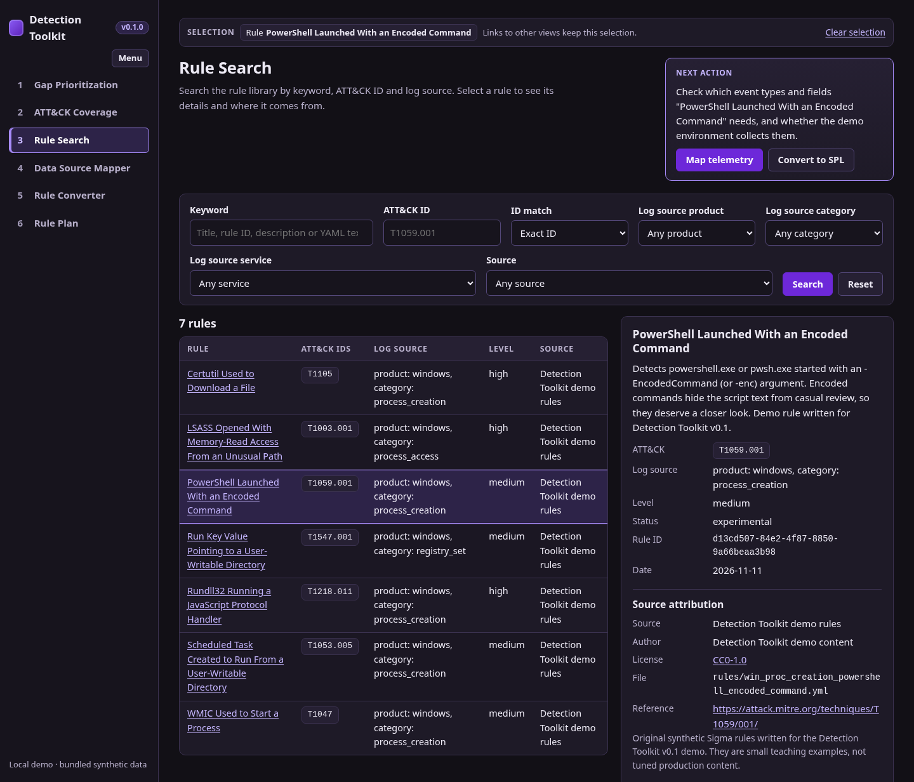

# Detection Toolkit v0.1

A standalone, local edition of Detection Toolkit with six views and a small bundled
demo dataset. It runs on one machine with Python, Flask and SQLite, needs no network
access at runtime, and does not connect to a SIEM.



| View | What it does |
| --- | --- |
| **Gap Prioritization** (start page) | Ranks ATT&CK technique families that need rule work and explains why. Each item links to its ATT&CK context, matching rules and telemetry requirements. |
| **ATT&CK Coverage** | Shows which techniques have rule content in the library and, separately, which have lab validation. Counts link to filtered Rule Search results. |
| **Rule Search** | Searches by keyword, ATT&CK ID (exact or whole family) and log source (product, category, service). Shows rule details, YAML and source attribution. |
| **Data Source Mapper** | For a selected rule, shows the event types and fields it needs and which ones the demo environment collects. Also runs a local check of the rule against the bundled demo events. |
| **Rule Converter** | Converts a selected or pasted Sigma rule to Splunk SPL with pySigma. Has a copy button and readable error messages. |
| **Rule Plan** | Creates and reopens plans with the ATT&CK ID, selected rule, telemetry requirements, validation status and notes. Plans are stored only in this edition's SQLite database. |

The selected ATT&CK ID and rule travel with you between views (`?technique=...&rule=...`)
and are shown in a selection bar at the top of every page.

> **Status:** community preview. All 22 automated tests passed on Linux with
> Python 3.12. See [Manual verification](#manual-verification).

---

## 1. Requirements

- Linux, or Windows with WSL 2 (tested distributions are not yet confirmed; Ubuntu 22.04 or 24.04 is a good start).
- Python 3.10 or newer, with `venv` and `pip`. pySigma 1.4.0 needs Python 3.10 or newer.
- About 150 MB of disk space for the virtual environment.
- Internet access once, to download the Python packages.

On Debian or Ubuntu (including WSL):

```bash
sudo apt update
sudo apt install -y python3 python3-venv python3-pip
```

pySigma depends on the `jq` Python package. Pre-built wheels exist for common Linux
x86_64 and arm64 systems. If `pip` has to build it from source, install a compiler
toolchain first: `sudo apt install -y build-essential autoconf automake libtool`.

## 2. Install

From the project directory (this README's folder):

```bash
python3 -m venv .venv
. .venv/bin/activate
python -m pip install --upgrade pip
python -m pip install -r requirements.txt
```

## 3. Configure (optional)

Every setting has a safe default. To change one, copy the example file, edit it, and
load it into your shell before running any command:

```bash
cp .env.example .env
# edit .env
set -a; . ./.env; set +a
python -m detection_toolkit check-config   # prints the resolved paths and settings
```

| Variable | Default | Meaning |
| --- | --- | --- |
| `DTK_HOST` | `127.0.0.1` | Bind address. Keep the loopback address: the app has no login. |
| `DTK_PORT` | `5000` | Port. |
| `DTK_DATA_DIR` | `data` | Runtime files (database and secret key). A relative path resolves from the project directory. |
| `DTK_DB_PATH` | `detection_toolkit.sqlite3` | SQLite file. A relative path resolves from `DTK_DATA_DIR`. |
| `DTK_TRUSTED_HOSTS` | `127.0.0.1,localhost` | Host names the app answers to (blocks DNS rebinding). `*` turns the check off. |
| `DTK_SECRET_KEY` | empty | Session-signing key. Empty means the key `init-db` writes to `$DTK_DATA_DIR/secret_key` (mode 0600) is used. If you set it, use at least 32 random characters. |
| `DTK_LOG_LEVEL` | `INFO` | Python log level. |

All paths are resolved from this project. Nothing refers to another installation.

## 4. Initialize the demo database

```bash
python -m detection_toolkit init-db
```

This creates `data/detection_toolkit.sqlite3` from the bundled seed files and writes
`data/secret_key`. Expected output lists 7 rules, 26 data sources, 5 event types,
15 technique requirements, 2 threat reports, 2 demo events and 1 plan.

`init-db` refuses to overwrite an existing database. To start over from the bundled
data (this deletes the plans you created):

```bash
python -m detection_toolkit init-db --reset
```

## 5. Start the app

```bash
python -m detection_toolkit serve                 # http://127.0.0.1:5000/
python -m detection_toolkit serve --port 8085     # or DTK_PORT=8085
```

Open the printed address in a browser. `/` opens Gap Prioritization. `GET /healthz`
returns `{"status": "ok", ...}` when the database is ready.

- **WSL 2:** keep `DTK_HOST=127.0.0.1` and browse from Windows to `http://localhost:5000/`.
  WSL forwards localhost by default.
- `serve` uses Flask's built-in server, which is fine for one local user. `wsgi.py`
  exposes `wsgi:app` if you later want a WSGI server; no production deployment
  configuration is included.
- If the database is missing, `serve` stops with a message, and the pages show
  setup instructions instead of the views.

Stop the server with Ctrl+C.

## 6. Demo walkthrough (PowerShell, T1059.001)

The bundled data contains one fully connected example:

- **Rule:** `PowerShell Launched With an Encoded Command`
  (`detection_toolkit/seed/rules/win_proc_creation_powershell_encoded_command.yml`).
  It is a small original Sigma rule, tagged `attack.t1059.001`, log source `windows / process_creation`.
- **Field mapping:** Sigma `process_creation` on Windows maps to Sysmon Event ID 1, with the
  same field names (`Image`, `OriginalFileName`, `CommandLine`, and others). Security 4688
  is the alternative (`Image` → `NewProcessName`; no `OriginalFileName`). See
  `detection_toolkit/seed/telemetry.json`.
- **Demo environment:** Sysmon Event ID 1 is available with all its fields. Security 4688 is
  partial (command-line logging is off). PowerShell 4104 and 4103 are missing.
- **Two synthetic events:** `detection_toolkit/seed/demo_events.json` (the same two events,
  one per line, are in `examples/sysmon-eid1-demo-events.jsonl`).

### Expected result for the two events

| Event | Command line (shortened) | Expected |
| --- | --- | --- |
| **Event A**: PowerShell with an encoded command | `powershell.exe -NoProfile -EncodedCommand VwBy...` (decodes to `Write-Output 'demo'`) | **Matches** the rule and the generated SPL: `Image` ends with `\powershell.exe`, `OriginalFileName` is `PowerShell.EXE`, and `CommandLine` contains ` -EncodedCommand `. |
| **Event B**: scheduled disk report script | `powershell.exe -NoProfile -ExecutionPolicy RemoteSigned -File C:\ProgramData\DemoScripts\Get-DiskReport.ps1` | **Does not match.** It is the same PowerShell binary, but the command line has no ` -enc ` or ` -EncodedCommand ` argument, so `selection_cli` fails. This is benign activity outside the rule. |

### Walk through the six views

1. **Gap Prioritization** opens first. `T1059.001 PowerShell` should be #1. Both sample
   reports rank it first (20 rank points), no plan covers the T1059 family, and the
   library has one matching rule. The panel on the right shows why it needs work, its
   ATT&CK context (link to attack.mitre.org), the matching rule and the telemetry guidance.
   That guidance should read **Low**, because the curated technique guidance wants PowerShell
   4104 script block logging and the demo lab does not collect it. T1053 (Scheduled Task) is
   listed under "Already covered or in a plan" because the seed includes an open
   sample plan for T1053.005 with validation pending. Click **Review the matching rule**.
2. **Rule Search** opens filtered to `T1059.001` with the rule selected. Check the source
   attribution (source, author, CC0-1.0 license, file, ATT&CK reference link) and the YAML.
   To try the log source filters, clear the ATT&CK ID field and pick category `registry_set`
   (one rule), then return to the PowerShell rule. Click **Map telemetry**.
3. **Data Source Mapper** shows the rule's detection fields (`CommandLine`, `Image`,
   `OriginalFileName`). Sysmon Event ID 1 should read **Ready** with 3 of 3 fields
   collected. Security 4688 should read **Partial**: `CommandLine` is not collected and
   `OriginalFileName` is not in that event. Under **Demo events**, click
   **Run local sample check**. The expected outcome is **passed**: Event A matched as
   expected and Event B did not match, as expected. This check runs the Sigma logic
   locally with pySigma in a sandboxed child process. It does not run the SPL. Click
   **Convert to SPL**.
4. **Rule Converter** loads the rule's YAML. Click **Convert to SPL**, then **Copy SPL**. The
   conversion runs pySigma in a child process with CPU, memory and time limits.
   With the default Splunk Windows pipeline, the SPL should look roughly like the line
   below. The exact formatting depends on the pySigma Splunk backend.

   ```text
   (Image IN ("*\\powershell.exe", "*\\pwsh.exe") OR OriginalFileName IN ("PowerShell.EXE", "pwsh.dll")) CommandLine IN ("* -enc *", "* -EncodedCommand *")
   ```

   The pipeline adds no index, source or EventCode condition for category-based rules such
   as `process_creation`, so scope the search yourself. Click **Add to Rule Plan**.
   (Optional, afterwards: paste broken YAML such as `title: [` and convert it to see a readable
   error with its line and column. Use **Load rule** to bring the library rule back.)
5. **Rule Plan** opens a new plan prefilled with `T1059.001`, the selected rule and the
   telemetry lines from the mapper. Set the validation status (for example
   *Implementable*) and create the plan. Open **Rule Plan** again to reopen it from the
   list. Creating a second plan for the same rule reopens the existing one instead.
   Validation states have rules: *Lab validated* needs a selected rule, telemetry and
   validation notes describing the evidence.
6. **ATT&CK Coverage** keeps two separate columns: **Rule content available** (7 of 94
   techniques in the subset) and **Lab validated** (empty in the bundled demo until a
   plan is marked *Lab validated*). Rule counts link to Rule Search filtered to
   that technique. Back in **Gap Prioritization**, T1059 now moves to "Already covered or in
   a plan" with a **Reopen plan** link.

### Optional: check the SPL in a test Splunk instance

The app never connects to Splunk. To confirm the expected results yourself, upload
`examples/sysmon-eid1-demo-events.jsonl` to a **test** index with sourcetype `_json`, then
run `index=<test index> sourcetype=_json <generated SPL>`. Expected: one result (Event A,
`ProcessId` 4312) and not Event B.

## 7. Tests

The tests in `tests/` cover the views, rule search, telemetry, planning, and the
demo Sigma-to-SPL conversion and sample event results.

```bash
python -m pip install -r requirements-dev.txt
python -m pytest
```

`tests/test_pysigma.py` is skipped when pySigma is not installed.

## 8. Project layout

```text
detection_toolkit/
  __init__.py          create_app(); checks the database before each request
  __main__.py, cli.py  python -m detection_toolkit {init-db, serve, check-config}
  config.py            DTK_* settings, path resolution, secret key
  db.py, schema.sql    SQLite connection helper, schema, init-db
  seed.py, seed/       bundled demo data and its loader
  attack.py            ATT&CK catalog subset and technique helpers
  rules.py             Rule Search queries
  coverage.py          ATT&CK Coverage
  gaps.py              Gap Prioritization ranking
  telemetry.py         Data Source Mapper (feasibility and rule field mapping)
  converter.py         Sigma to SPL with pySigma
  sigma_eval.py        local sample check (sandboxed child process)
  (converter.py also runs pySigma in a sandboxed child process)
  plans.py             Rule Plan storage and validation rules
  security.py          CSRF, same-origin check, security headers
  views.py             the six views
  templates/, static/  UI (no external assets)
data/                  runtime files (created by init-db; ignored by Git)
examples/              the two demo events as JSON Lines
licenses/              MITRE ATT&CK license text
tests/                 automated tests
```

## 9. Security and privacy notes

- The app is for one local user. It has no login, so it binds to `127.0.0.1` by default
  and answers only to the host names in `DTK_TRUSTED_HOSTS`.
- Every form post needs a session-bound CSRF token. Cross-site posts are rejected.
- The Content-Security-Policy allows only same-origin scripts and styles; there is no
  inline script or style.
- Seed files and pasted rules are parsed as data (`yaml.safe_load`, `json.loads`); YAML aliases
  are refused in pasted rules. The Rule Converter and the local sample check run pySigma in a
  child process with CPU, memory and time limits.
- No runtime network access: no feed sync, no ATT&CK download, no SIEM connection. The
  only external links are to attack.mitre.org and the rule license page, and they open in
  the browser.

## 10. Scope

This edition contains only the six views above and the bundled demo data. It has no
login, no rule feed sync, no SIEM integration and no production deployment
configuration. Rule plans keep only the fields listed above.

## 11. Data and licenses

- The ATT&CK subset is © The MITRE Corporation, reproduced with permission. See
  `licenses/MITRE-ATTACK-LICENSE.txt`.
- The demo rules, events, threat rankings, inventory, event types and field mappings were
  written for this edition and are dedicated to the public domain (CC0-1.0). The threat
  rankings are fictional and are not real threat intelligence.
- The project code, including code reused from the earlier Detection Toolkit, and the
  `technique_requirements` guidance in `telemetry.json` have no license grant in this
  preview. See `THIRD_PARTY_NOTICES.md` for the scope of each bundled data license.

## Manual verification

Manual checks for this preview include narrow layouts, keyboard navigation, plan edit
conflicts, and the generated SPL against the two demo events in a test Splunk index.
